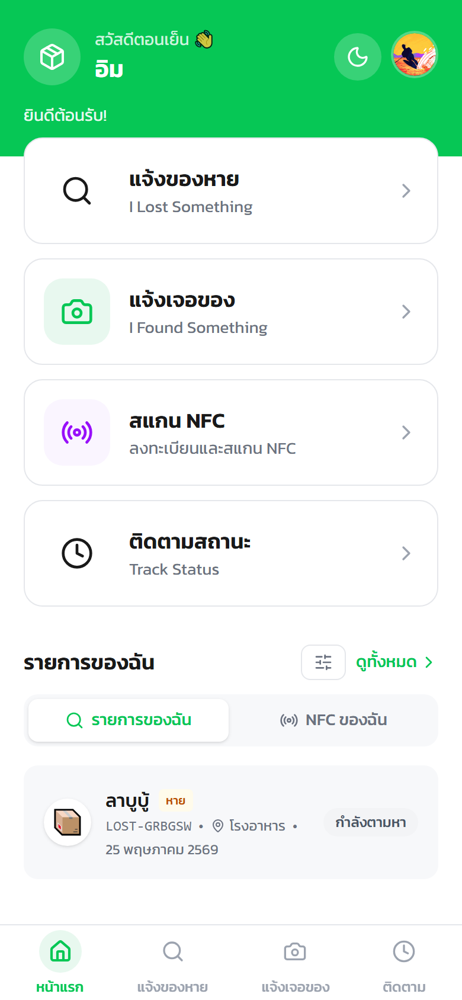
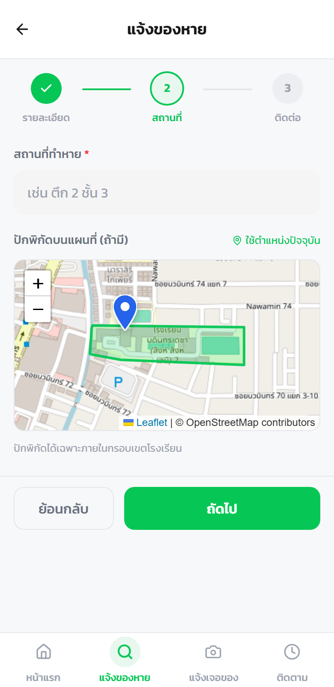
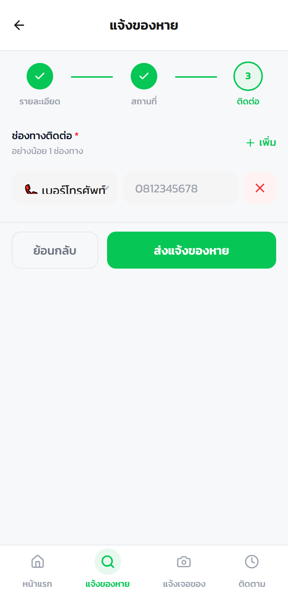
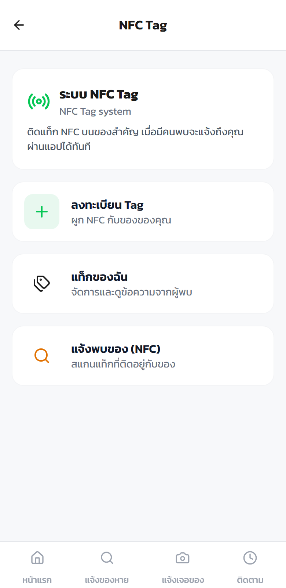

<p align="center">
  
</p>

<h1 align="center">Found-U</h1>
<p align="center">ระบบแจ้งของหาย–ของเจอสำหรับโรงเรียน พร้อมผู้ช่วย AI และแท็ก NFC</p>

<p align="center">
  <a href="https://foundu.forum">foundu.forum</a> ·
  <a href="https://foundu.bodin2.ac.th">foundu.bodin2.ac.th</a> ·
  เวอร์ชัน <code>0.3</code>
</p>

---

ของหายในโรงเรียนมักจบลงที่ห้องแนะแนวหรือกระดานประกาศ ตามหาก็ยาก แจ้งก็ลืม สุดท้ายของก็ไม่ได้กลับไปหาเจ้าของ Found-U ทำให้คนที่ทำของหายกับคนที่เจอของนัดเจอกันได้ในที่เดียว มีรหัสติดตามสถานะ มีระบบจับคู่อัตโนมัติ และมีผู้ช่วย AI ที่คุยแล้วแจ้งของหาย/เจอให้เสร็จในตัว

<table>
<tr>
<td></td>
<td></td>
<td></td>
<td></td>
</tr>
</table>

## ระบบทำอะไรได้

- **แจ้งของหาย / ของเจอ** พร้อมรูป ตำแหน่ง (ปักหมุดในแผนที่ + ตรวจ GPS ว่าอยู่ในเขตโรงเรียน) และช่องทางติดต่อ
- **รหัสติดตาม (Tracking Code)** ให้เช็กสถานะได้โดยไม่ต้องล็อกอินซ้ำ พร้อมซ่อนข้อมูลติดต่อของคนอื่นเพื่อความเป็นส่วนตัว
- **จับคู่อัตโนมัติ** ระหว่างรายการของหายกับของเจอ
- **ผู้ช่วย AI** ที่หน้า `/assistant` — คุยเพื่อค้นหา แจ้งรายการ จับคู่ วิเคราะห์รูป หรือเช็กสถานะได้ในแชทเดียว รองรับ Gemini และ OpenRouter พร้อม fallback อัตโนมัติ
- **AI วิเคราะห์รูป** เดาชื่อ หมวดหมู่ สี ยี่ห้อจากภาพถ่าย และ **AI แยกข้อมูลจากข้อความ** ตอนแจ้งของหาย
- **ค้นหา** ที่ทนคำใกล้เคียงได้ ทั้งหน้ารายการและในผู้ช่วย AI
- **แท็ก NFC** ติดของสำคัญ สแกนแล้วแจ้งเจ้าของได้ทันที ไม่ต้องพิมพ์ URL เอง (รองรับ NTAG213/215/216 เขียน Read-only บน Android และพิมพ์ QR สำรองสำหรับ iOS)
- **แผงแอดมิน** ครบ — จัดการรายการ ผู้ใช้ นักเรียน การจับคู่ moderation ตั้งค่า AI และดู debug log ของ Agent

<details>
<summary>ประวัติเวอร์ชันย่อ</summary>

**v0.3 — AI Agent & การค้นหาอัจฉริยะ**
ผู้ช่วย AI แบบ tool-calling, Gemini + OpenRouter fallback, fuzzy search ด้วย `pg_trgm`, ประวัติแชทเก็บใน IndexedDB (Dexie), แผงแอดมิน AI Center และ Agent Debug Log

**v0.2b — ย้ายไป Supabase**
เปลี่ยนจาก Firebase มา Supabase (Postgres + Auth + Realtime + RLS), ล็อกอินหลักด้วยเลขประจำตัว/รหัสแอดมิน + รหัสผ่าน, เพิ่ม Passkey และ PIN เป็นช่องทางรอง, ตัด Google OAuth, validate ด้วย Zod ทุก API หลัก

**v0.1.3beta — NFC Tag**
ลงทะเบียนแท็ก NFC, เขียน URL + ล็อก Read-only, พิมพ์ QR สำรองสำหรับ iOS, แจ้งพบของผ่านสแกน/QR

</details>

## การยืนยันตัวตน

| วิธี | นักเรียน | แอดมิน | หมายเหตุ |
|------|:-:|:-:|----------|
| เลขประจำตัว + รหัสผ่าน | ✓ | — | ช่องทางหลัก ใช้ล็อกอินครั้งแรกเสมอ |
| เลขแอดมิน 5 หลัก + รหัสผ่าน | — | ✓ | ช่องทางหลักของแอดมิน |
| Passkey (WebAuthn) | ✓ | ✓ | ลงทะเบียนได้หลังล็อกอินรหัสผ่านสำเร็จ |
| PIN | ✓ | ✓ | ตั้งได้หลังล็อกอินรหัสผ่านสำเร็จ |

## เทคโนโลยีที่ใช้

เว็บที่นักเรียนเปิดเป็นไฟล์นิ่งจาก Next.js ไม่มีเซิร์ฟเวอร์ Node ตอนให้บริการ API เป็น PHP

| ส่วน | ใช้อะไร |
|------|---------|
| หน้าเว็บ | Next.js 16 (static export) + React 19 + TypeScript |
| สไตล์ | Tailwind CSS 4 |
| API | PHP 8.2.36 ขึ้นไป, Slim 4, PDO แนะนำเลือก 8.3 หรือ 8.4 ในแผงโฮสต์ |
| ฐานข้อมูล | MariaDB |
| รูปและแบ็กอัป | Cloudflare R2 |
| แชท | Gemini หรือ OpenRouter เรียกจาก PHP ได้ทีละคำตอบ |
| แผนที่ | Leaflet + OpenStreetMap |
| หน้าบ้านโดเมน | Cloudflare Free |

## โครงสร้างโปรเจกต์

```text
app/            หน้าเว็บที่ถูก export เป็น HTML
components/     UI, แผนที่, กล้อง, แชท
public_html/    สิ่งที่ Apache เสิร์ฟ รวม api/index.php
foundu/         โค้ด PHP, migration, cron, ค่า .env.php
docker/         Apache + PHP + MariaDB สำหรับลองในเครื่อง
docs/php-port/  บันทึกการพอร์ต วิธีขึ้นเว็บ และสิ่งที่ต้องทำตอนเว็บล่ม
```

## ลองในเครื่อง

ต้องมี Docker กับ Node (ใช้ตอนสร้างไฟล์นิ่ง ไม่ได้รันบนโฮสต์)

```bash
git clone https://github.com/bodin2/found-u.git
cd found-u
npm install
make up
```

เปิด http://localhost:8080 ฐานข้อมูลและค่า `.env.php` ถูกสร้างให้ใน container ของที่ต้องรู้ก่อนขึ้นโฮสต์อยู่ในหัวข้อด้านล่าง ขั้นตอนขึ้นเว็บจริงอยู่ใน [docs/php-port/go-live.md](docs/php-port/go-live.md)

| คำสั่ง | ใช้ทำอะไร |
|--------|-----------|
| `make test` | migration, แล้ว PHPUnit |
| `make logs` | ดูล็อกของ container |
| `npm run typecheck` | เช็ก TypeScript |
| `npm run build-release` | สร้าง `dist/foundu-release.zip` สำหรับอัปขึ้นโฮสต์ |

PHPUnit บน 8.3 หรือ 8.4 ใช้ `SERVICE=web83 foundu/bin/phpunit.sh` และ `SERVICE=web84 foundu/bin/phpunit.sh`

## ขึ้นเว็บโรงเรียน

โฮสต์เป้าหมายคือ DirectAdmin ไม่มี SSH และไม่มี Node ตอนให้บริการ ขั้นตอนทีละข้อภาษาไทยอยู่ใน [docs/php-port/go-live.md](docs/php-port/go-live.md) ค่าที่ต้องกรอกอยู่ใน `foundu/config/.env.php.example` เมื่อเว็บมีปัญหาให้อ่าน [docs/php-port/runbook.md](docs/php-port/runbook.md)

## ทีมงาน

- [Athivaratz](https://www.instagram.com/athivaratz)
- [Almond](https://www.instagram.com/ohzzl_)
- [Prim](https://www.instagram.com/aeridesrosea.v)

**ที่ปรึกษาโครงการ:** [ratchanon_roj](https://www.instagram.com/ratchanon_roj) และอาจารย์อภิชาติ พูลสวัสดิ์

---

โครงการ Found-U : ระบบแจ้งของหาย-ของเจอสำหรับโรงเรียนด้วยปัญญาประดิษฐ์ และเทคโนโลยี NFC ได้รับทุนอุดหนุนการทำกิจกรรมส่งเสริมและสนับสนุนการวิจัยและนวัตกรรมจากสำนักงานการวิจัยแห่งชาติ และสำนักงานพัฒนาวิทยาศาสตร์และเทคโนโลยีแห่งชาติ
This research and innovation activity is funded by National Research Council of Thailand (NRCT) and National Science and Technology Development Agency (NSTDA) [สำนักงานการวิจัยแห่งชาติ (วช.)](https://nrct.go.th) และ [สำนักงานพัฒนาวิทยาศาสตร์และเทคโนโลยีแห่งชาติ (สวทช.)](https://www.nstda.or.th)

---

## ก่อนเอาขึ้นโฮสต์

- ใน DirectAdmin ให้เลือก PHP 8.3 หรือ 8.4 PHP 8.2 หมดอายุวันที่ 31 ธ.ค. 2026 ถ้าตัวที่รันต่ำกว่า 8.2.36 `api/index.php` ตอบ 503
- MariaDB ในเครื่องคือ 10.11.20 ไม่ใช้ 10.6 SQL ใช้ได้กับ 10.11 และ 11 ถ้ารุ่นบนโฮสต์ต่ำกว่านี้ให้บอกก่อนนำเข้า schema
- `session.upload_progress.enabled` ถูกปิดใน `docker/php/php.ini`, `public_html/.user.ini` และตอนบูตของ `api/index.php`
- zip ที่อัปมี `public_html/` กับ `foundu/` นอก web root รวม `foundu/vendor` โฮสต์ไม่มี composer และไม่มี SSH
- ก็อป `foundu/config/.env.php.example` เป็น `.env.php` แล้ว chmod 600 อย่าอัปไฟล์ที่ container สร้างให้
- `.htaccess` เปิดเฉพาะ IP ของ Cloudflare Docker สร้าง `public_html/.cf-allowlist-off` เพื่อปิดด่านนี้ในเครื่อง อย่าอัปไฟล์นั้น ถ้าโฮสต์เขียน `REMOTE_ADDR` ทับเป็นไอพีผู้เยี่ยม บล็อก `Require ip` จะ 403 ทุกคน อ่าน [docs/php-port/cloudflare.md](docs/php-port/cloudflare.md)
- ไม่มี Redis ตัวนับอยู่ที่ MariaDB APCu เป็นทางลัดถ้าโฮสต์เปิดให้ cron คือ `*/5 * * * * php ~/foundu/bin/cron.php`
- body ที่ Apache รับได้คือ 1.5 MiB PHP ยังตัดคำขอธรรมดาที่เกิน 256 KiB และคำขอแชทที่เกิน 64 KiB รูปใน vision กับแชทไปได้ถึง 1.5 MiB

## อื่น ๆ

- ความปลอดภัยและการรายงานช่องโหว่: [SECURITY.md](SECURITY.md)
- สิทธิ์การใช้งาน (GNU Lesser General Public License v3 หรือรุ่นถัดไป) และข้อตกลงการใช้ซอฟต์แวร์ตามเงื่อนไข NSC 2026: [LICENSE](LICENSE)

---

<details>
<summary><strong>English summary</strong></summary>

Found-U is a school lost-and-found web app. Reporters and finders coordinate through tracking codes and automatic matching. The assistant can search, file a report, and read a photo in one reply. NFC tags let someone who finds a tagged item message the owner.

The pages are a static Next.js export. The API is PHP (Slim 4) on MariaDB, with pictures and backups in Cloudflare R2. `make up` serves the site at http://localhost:8080. The shared-host steps, in Thai, are in `docs/php-port/go-live.md`. There is no Node process on the host, no SSH, and no Redis.

This research and innovation activity is funded by National Research Council of Thailand (NRCT) and National Science and Technology Development Agency (NSTDA).

License: GNU Lesser General Public License v3.0 or later (LGPL-3.0-or-later), together with the NSC 2026 software-use disclaimer — see [LICENSE](LICENSE). Security reports: see [SECURITY.md](SECURITY.md).

</details>

<p align="center">Made with ❤️ by <a href="https://www.instagram.com/athivaratz">Athivaratz</a> & Team</p>
